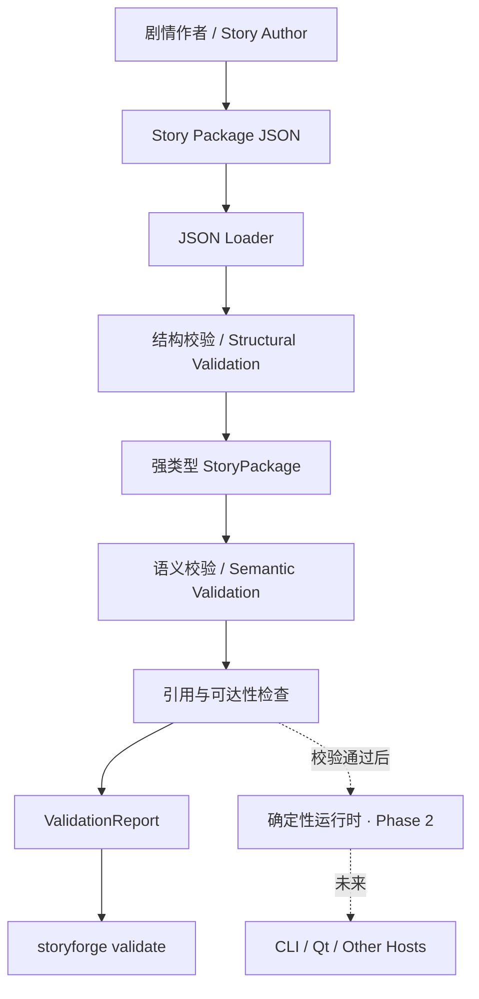

# TaleState C++ 📖

> A deterministic, data-driven narrative validation engine for branching text RPGs, built with modern C++20 and JSON.
>
> 使用现代 C++20 与 JSON 构建的、确定性且数据驱动的分支文字 RPG 剧情校验引擎。

---

## 项目简介 / About

### 中文

**TaleState C++** 是一个独立、与具体世界观无关的文字 RPG 剧情引擎项目。

剧情作者使用 JSON 描述章节、场景、节点、选项、条件与效果；C++ 核心负责把这些不可信输入转换为强类型模型，并在内容进入运行时之前检查格式、引用和剧情图结构。项目强调确定性、可测试性和清晰的安全边界，可作为命令行工具使用，也计划作为库接入桌面游戏或其他客户端。

当前版本完成了 **Phase 0：项目骨架** 与 **Phase 1：剧情格式及校验器**。它已经可以验证 Story Package v1，但还不能直接游玩剧情。

### English

**TaleState C++** is a standalone, setting-agnostic narrative engine project for branching text RPGs.

Story authors describe chapters, scenes, nodes, choices, conditions, and effects in JSON. The C++ core converts this untrusted input into strongly typed models, then validates its structure, references, and narrative graph before it can reach a runtime. The project focuses on determinism, testability, and explicit trust boundaries, with both library integration and command-line usage in mind.

The current release covers **Phase 0: project foundation** and **Phase 1: story format and validation**. Story Package v1 validation is available; interactive play is not implemented yet.

---

## ✨ 已实现功能 / Implemented Features

### 👤 使用者视角 / For Story Authors

| 功能 | 说明 |
|---|---|
| 📦 Story Package v1 | 使用 JSON 编写章节、场景、节点、分支选项、条件和效果 |
| ✅ 剧情包校验命令 | 使用 `storyforge validate <目录或文件>` 检查内容包 |
| 🧱 结构错误诊断 | 检查 JSON 语法、必填字段、字段类型、未知字段、ID 和版本格式 |
| 🔗 剧情引用诊断 | 检查无效入口、缺失变量、错误节点、场景和章节引用 |
| 🗺️ 可达性检查 | 从剧情入口遍历显式跳转，拒绝无法到达的节点 |
| 🧭 精确错误位置 | 输出错误代码、JSON 路径和可读错误信息，并返回非零退出码 |
| 🏫 原创示例世界 | 提供“钟塔学院：失准的晨钟”，包含两个调查分支和两个结局 |
| 📐 机器可读规范 | 提供 Story Package v1 JSON Schema 和对应格式说明 |

> 当前工具的直接使用者是剧情包作者与集成开发者。面向最终玩家的 `play` 命令将在确定性运行时完成后提供。

### 👨‍💻 开发者视角 / For Developers

| 实现 | 技术说明 |
|---|---|
| 🧩 强类型领域模型 | 章节、场景、节点、选项、变量等使用不同的强类型 ID |
| 🔀 条件与效果模型 | 使用 `std::variant` 表达类型化条件和效果，避免核心逻辑依赖巨大字符串分支 |
| 🪹 递归组合条件 | 支持 `all`、`any`、`not` 以及变量、物品、金币、场景、事件和 NPC 记忆条件 |
| ⚙️ 通用效果类型 | 建模变量修改、金币、物品、场景切换、章节推进、NPC 记忆、事件和叙事追加 |
| 📥 安全 JSON 加载 | 使用 nlohmann/json；限制输入为 16 MiB，并在构造模型前执行结构检查 |
| 🛡️ 两阶段校验 | 分离结构校验与跨对象语义校验，生成统一 `ValidationReport` |
| 🕸️ 图遍历诊断 | 从入口沿节点、场景和章节跳转分析不可达内容 |
| 🧰 可复用核心库 | 校验能力位于独立 `storyforge` C++ 库，不依赖 Qt、MySQL 或 AI Provider |
| 🧪 自动化测试 | Catch2 覆盖合法包、损坏 JSON、缺字段、重复 ID、坏引用、非法效果与不可达节点 |
| 🔄 跨平台 CI | GitHub Actions 在 Windows 与 Linux 上构建、测试并验证示例剧情包 |

---

## 🛠️ 技术栈 / Tech Stack

| 层次 / Layer | 技术 / Technology |
|---|---|
| 开发语言 / Language | **C++20** |
| 构建系统 / Build | **CMake 3.24+** |
| JSON 解析 / Parsing | **nlohmann/json 3.11.3** |
| 格式规范 / Schema | **JSON Schema Draft 2020-12** |
| 命令行 / CLI | **CLI11 2.4.2** |
| 自动测试 / Testing | **Catch2 3.7.1 + CTest** |
| 持续集成 / CI | **GitHub Actions — Windows + Linux** |
| 许可证 / License | **MIT** |

---

## 🏗️ 系统架构 / Architecture



### 安全边界 / Trust Boundary

```text
用户世界设定
    ↓
候选剧情 JSON（始终视为不可信输入）
    ↓
结构校验
    ↓
C++ 语义校验
    ↓
自动模拟与人工确认（后续阶段）
    ↓
可发布剧情包
```

剧情 JSON 不能执行代码、直接修改数据库或绕过 C++ 规则。未来接入 AI 时，AI 也只能生成候选 JSON，不能决定内容是否有效。

---

## 📂 项目结构 / Project Structure

```text
talestate-cpp/
├── CMakeLists.txt                    # 顶层构建配置与固定版本依赖
├── README.md                         # 项目说明和快速开始
├── LICENSE                           # MIT License
├── SECURITY.md                       # 输入边界与安全报告方式
├── CONTRIBUTING.md                   # 贡献与测试约定
│
├── include/storyforge/               # 公共 C++ API
│   ├── model/story_types.hpp         # 强类型 ID、条件、效果和 Story Package
│   ├── io/story_loader.hpp           # JSON 加载接口
│   └── validation/validation.hpp     # 校验问题、报告和校验入口
│
├── src/
│   ├── io/story_loader.cpp           # JSON 解析与结构检查
│   └── validation/story_validator.cpp # 引用、效果与图可达性检查
│
├── apps/storyforge-cli/
│   └── main.cpp                      # storyforge validate 命令
│
├── schemas/
│   └── story-package-v1.schema.json # Story Package v1 JSON Schema
│
├── examples/clockwork-academy/
│   └── story.json                    # 原创双分支示例剧情
│
├── tests/
│   ├── loader_tests.cpp              # 加载与结构校验测试
│   ├── validator_tests.cpp           # 语义与可达性测试
│   └── fixtures/                     # 非法剧情包测试数据
│
└── docs/format/
    └── story-package-v1.md           # Story Package v1 格式说明
```

---

## 📊 当前进度 / Progress

### ✅ 已完成 / Completed

- [x] C++20 与 CMake 项目骨架
- [x] Windows / Linux GitHub Actions
- [x] Story Package v1 数据格式与 JSON Schema
- [x] 强类型剧情领域模型
- [x] 条件与效果 `std::variant` 类型系统
- [x] JSON 加载和结构校验
- [x] 重复 ID 与缺失引用检查
- [x] 剧情入口和归属关系检查
- [x] 非法变量效果检查
- [x] 剧情节点可达性分析
- [x] `storyforge validate` 命令
- [x] 原创分支剧情示例
- [x] 9 项自动化测试

### 🚧 下一阶段 / Next Phase

- [ ] 条件求值
- [ ] 效果计算
- [ ] `StoryCommand → StoryDelta → StoryEvent`
- [ ] `StoryDelta` 完整验证与原子提交
- [ ] `storyforge play`
- [ ] 固定随机种子与黄金结果测试

### 📋 后续规划 / Planned

- [ ] 自动模拟、死路和目标可完成性诊断
- [ ] 内存状态存储与 SQLite 持久化
- [ ] 存档版本和迁移机制
- [ ] AI 候选剧情生成与自动修复闭环
- [ ] Qt 及其他宿主适配器

---

## 🚀 快速开始 / Quick Start

### 环境要求 / Prerequisites

| 依赖 | 版本 |
|---|---|
| CMake | 3.24+ |
| 编译器 | MSVC 2022 / GCC 11+ / Clang 14+ |
| C++ 标准 | C++20 |

首次配置会从官方仓库下载并校验固定版本的 nlohmann/json、CLI11 和 Catch2。

### 1️⃣ 获取源码 / Clone

```bash
git clone https://github.com/stellablack528/talestate-cpp.git
cd talestate-cpp
```

### 2️⃣ 配置与构建 / Configure and Build

```bash
cmake -S . -B build -DSTORYFORGE_BUILD_TESTS=ON
cmake --build build --config Release
```

### 3️⃣ 验证示例剧情 / Validate the Example

Linux 或单配置生成器：

```bash
./build/storyforge validate examples/clockwork-academy
```

Visual Studio 等多配置生成器：

```powershell
.\build\Release\storyforge.exe validate .\examples\clockwork-academy
```

成功输出：

```text
valid Story Package v1: 钟塔学院：失准的晨钟 (clockwork-academy @ 0.1.0)
1 chapter(s), 0 warning(s)
```

也可以直接传入 JSON 文件：

```bash
storyforge validate examples/clockwork-academy/story.json
```

---

## 🧪 测试 / Testing

```bash
ctest --test-dir build -C Release --output-on-failure
```

当前自动测试覆盖：

- 合法 Story Package 的加载和校验
- 损坏 JSON 的拒绝
- 缺失必填字段
- 未知字段、非法 ID 与版本号
- 重复标识符
- 缺失节点引用
- 无效剧情入口
- 不可达节点
- 非法变量效果

当前基线：**9/9 测试通过**。

---

## 📝 Story Package v1 顶层结构示意

```json
{
  "format": "storyforge.package/v1",
  "id": "example-story",
  "title": "Example Story",
  "version": "0.1.0",
  "entry": {
    "chapter": "chapter.start",
    "scene": "scene.hall",
    "node": "node.entry"
  },
  "variables": [],
  "chapters": []
}
```

完整字段定义见 [Story Package v1 格式说明](docs/format/story-package-v1.md) 和 [JSON Schema](schemas/story-package-v1.schema.json)。请注意：上面的片段只展示顶层形状，空章节数组不能通过语义校验；可运行示例请参考 [Clockwork Academy](examples/clockwork-academy/story.json)。

---

## 🎯 项目目标 / Goals

- 构建一个不绑定具体世界观的现代 C++ 文字 RPG 剧情引擎。
- 将剧情内容、规则执行、UI、数据库与 AI Provider 解耦。
- 让所有剧情执行可验证、可测试、可复现。
- 为未来的 AI 剧情生成建立严格的候选内容安全边界。
- 作为现代 C++、状态机、图遍历、事务和软件架构的渐进式实践项目。

---

## 👤 维护者 / Maintainer

[@stellablack528](https://github.com/stellablack528)

---

## 📄 License

MIT License — See [LICENSE](LICENSE) for details.
