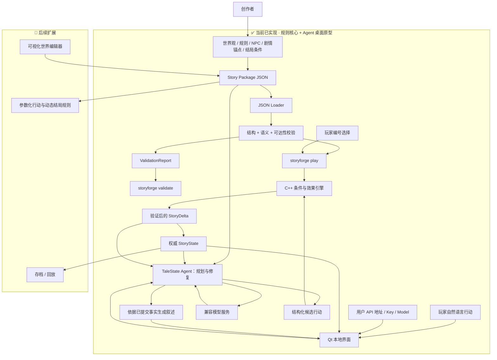

# TaleState C++ 📖


> Bring your own model. The model understands and narrates; the C++ engine enforces the world's rules.
>
> 用户自带 API Key，让现成大模型负责理解、规划和叙述，由 C++ 引擎维护可信的游戏世界。

---

## 项目简介 / About

### 中文

**TaleState C++** 是一个独立的高自由度文字 RPG Agent 引擎项目。

**核心分工：现成大模型理解玩家意图、规划行动并生成叙述；C++ 引擎校验世界规则、执行合法动作并维护权威游戏状态。**

创作者负责定义世界观、世界规则、地点、NPC、剧情锚点以及多个结局，但不需要预先写死玩家抵达结局的每一条路线。玩家可以用自然语言自由行动；剧情 Agent 根据世界状态理解意图、扮演 NPC，并生成候选场景、事件与叙述。C++ 引擎是世界事实的唯一裁判，负责验证 Agent 提出的状态变化、原子提交合法结果，并保证物品、金币、关系、事件和结局条件不会被 AI 随意绕过。

项目采用 **BYOK（Bring Your Own Key）**：用户选择自己信任的兼容模型服务，填写 API 地址、API Key 和模型名称。TaleState 不重新训练一个基础模型，而是提供已经为文字 RPG 工程化的 Agent 能力，包括角色职责、上下文组装、可用动作、结构化输出、规则校验、失败修复和记忆管理。用户不需要自己研究复杂提示词，也不必把游戏绑定到某一家模型供应商。

项目追求的不是无限制的 AI 即兴创作，而是**受约束的生成式叙事（Constrained Generative Narrative）**：创作者决定世界与命运的边界，Agent 创造旅途中的道路，玩家决定如何行动，引擎保证世界规则始终可信。

当前版本提供两种入口：命令行的固定选项玩法，以及可选构建的 **Qt 本地桌面原型**。桌面原型支持导入带 Agent 规则的世界包、填写自己的兼容模型 API、自然语言输入、Agent 规划与修复、C++ 权威状态裁决、生成式叙述以及手动存档／读档。通用行动协议 v1 支持带参数的跨场景移动、NPC 交谈、观察、拿取、给予与使用；示例包含钟塔学院与雾港两个不同世界。创作者可以输入世界观生成地图草案，也可以进一步生成三地点、2–3 名人物、开局目标和三件可收集证据组成的探索世界包。证据可用于一次环境互动；NPC 能根据单件证据、两件证据组合和已发生的互动事件回答。寻找与交谈顺序不固定。生成器还会提出可检查的身份、属性和成长行动规格，由 C++ 编译为受条件、花费与数值上下限约束的行动。生成包尚无自动生成的结局。

### English

**TaleState C++** is a standalone, setting- and provider-agnostic agent runtime for high-freedom text RPG worlds.

**Core division of work:** an existing language model interprets player intent, plans actions, and writes narration. The C++ engine checks world rules, executes valid actions, and maintains the authoritative game state.

Creators define the world, hard rules, locations, NPCs, story anchors, and possible endings without scripting every route between them. Players act through natural-language input. A narrative agent interprets intent and proposes scenes, events, NPC reactions, and narration, while the deterministic C++ engine remains the sole authority over world state and ending conditions.

The goal is constrained generative narrative rather than unrestricted AI improvisation: creators set the boundaries, the agent creates possible paths, players decide how to act, and the engine ensures that the world never cheats.

TaleState uses a BYOK model: users supply the endpoint, API key, and model of a compatible service. TaleState supplies the RPG-specific agent workflow, structured actions, validation, repair, and memory strategy, so model choice does not define the rules of the world.

The current release also includes an optional Qt desktop prototype: import a world package, enter an OpenAI-compatible endpoint/key/model, type free-form actions, and see model planning, repair, narration, and C++-committed state. Manual saves restore authoritative world state without storing credentials or chat history. A parameterized action protocol supports movement, conversation, inspection, pickup, giving, and item use across two example worlds. Creators can turn a world brief into a map draft or a three-location exploration package with an opening goal and two or three NPCs. The generator also proposes typed identity, attribute, and growth rules; C++ compiles valid rules into bounded actions and a one-time identity choice. The generated package can be loaded for exploration and conversation; generated endings and richer item rules remain future work.

---

## 🔑 开箱即用的 BYOK 模式 / Bring Your Own Key

最终用户不需要训练模型，也不需要从零编写一套文游提示词。首次启动时可选择 OpenAI、DeepSeek、OpenRouter、硅基流动预设，或选择“自定义 · OpenAI 兼容”，然后填写：

```text
API 类型：OpenAI-compatible Chat Completions
Base URL：https://你的模型服务地址/v1
API Key：由用户自己的模型服务商提供
Model：用户选择的模型名称
```

预设仅填写默认 API 地址，不代替用户选择模型或保证所有模型兼容。切换服务商会清空旧 API Key 和模型名，避免把旧 Key 发往新地址；地址仍可自行修改。当前使用 `/chat/completions` 协议；原生 Anthropic Messages、Gemini 原生接口及 OpenAI Responses 尚未实现。默认地址参考各服务商官方文档：[OpenAI](https://developers.openai.com/api/reference/resources/chat)、[DeepSeek](https://api-docs.deepseek.com/quick_start/agent_integrations/)、[OpenRouter](https://openrouter.ai/docs/api/api-reference/chat/send-chat-completion-request)、[硅基流动](https://docs.siliconflow.cn/docs/userguide/quickstart)。

TaleState 在模型与游戏世界之间提供同一套专用能力：

| TaleState 提供 | 用户获得 |
|---|---|
| 文游 Agent 的角色与工作流 | 模型知道自己何时规划、何时调用规则、何时只负责叙述 |
| 精简且有权限边界的上下文 | NPC 不该知道的秘密不会仅因为模型“猜到”就成为世界事实 |
| 结构化候选命令 | 大模型输出先变成可检查的数据，而不是直接篡改存档 |
| 校验失败后的修复循环 | 非法行动会被解释和重试，不会将半套错误结果写入世界 |
| 统一 Provider 接口 | 更换兼容模型时不需要重写剧情和规则引擎 |
| C++ 权威状态与事件日志 | 物品、金币、关系、时间和结局条件保持可验证、可追踪 |

> 这里的“开箱即用”是指 TaleState 会把文字 RPG 所需的 Agent 能力预设并工程化，而不是替用户训练或微调一个新的基础模型。用户带来模型能力，TaleState 让这份能力遵守同一套游戏规则。

**一句话原则：AI 负责想象，TaleState 负责让世界保持真实。**

---

## ✨ 已实现功能 / Implemented Features

### 👤 使用者视角 / For Story Authors

| 功能 | 说明 |
|---|---|
| 📦 Story Package v1 | 使用 JSON 编写受控场景、剧情锚点原型、选项、条件和效果 |
| ✅ 剧情包校验命令 | 使用 `storyforge validate <目录或文件>` 检查内容包 |
| 🎮 C++ 可玩闭环 | 使用 `storyforge play <目录或文件>` 选择行动，推进状态并抵达结局 |
| 🧱 结构错误诊断 | 检查 JSON 语法、必填字段、字段类型、未知字段、ID 和版本格式 |
| 🔗 剧情引用诊断 | 检查无效入口、缺失变量、错误节点、场景和章节引用 |
| 🗺️ 可达性检查 | 从剧情入口遍历显式跳转，拒绝无法到达的节点 |
| 🧭 精确错误位置 | 输出错误代码、JSON 路径和可读错误信息，并返回非零退出码 |
| 🏫 原创示例世界 | 提供“钟塔学院：失准的晨钟”，用固定双分支验证格式与校验流程 |
| 📐 机器可读规范 | 提供 Story Package v1 JSON Schema 和对应格式说明 |
| 🔑 BYOK 接入 | 在桌面原型中选择服务商预设或自定义兼容接口，再输入 API 地址、Key 和模型名称；Key 仅保留在本次运行内存中 |
| 🔎 测试连接 | 无须先导入世界包，即可发送一次简短请求，检查基础对话连接并区分网络、认证、模型／接口等常见错误 |
| 💾 手动存档／读档 | 保存并恢复地点、回合、金币、背包、变量、NPC 记忆与关系、已发生事件；校验世界包 ID／版本，不保存 API Key |
| 🕒 时间与约定初版 | 世界包可声明 NPC 参与的预约活动；玩家能等待、预约、到场履约，时间冲突与错过由 C++ 检查，时间和约定状态随存档恢复 |
| 📝 动态事实初版 | 调查生成待核实线索、向在场 NPC 作出承诺或求助、约定计划事件；来源、期限、重复 ID 与履约状态经 C++ 检查并随存档恢复。生成的线索尚不等于已证实真相 |
| 🎁 Windows 示例包 | 打开桌面程序可一键载入雾港灯塔示例；填写兼容模型的 API 地址、Key 和模型名后即可自由输入行动 |
| 📝 世界设定表 | 在桌面端按背景、玩家目标、地点、人物、规则等条目填写，也可自由新增或改名；草稿可导入、保存，生成地图与世界包时按字段传给模型 |
| 🖥️ 本地桌面原型 | 导入带 Agent 规则的世界包，配置自己的模型，在界面中自由输入并查看剧情和权威状态 |
| 🧭 Agent 规则组合 | 通过自然语言选择并组合创作者授权的行动，不必预写每条完整剧情路线 |
| 🚶 通用行动协议 v1 | 用同一套 `move` / `talk` 请求在不同世界移动与交谈；非法目标、封锁路线和不在场的 NPC 都会被拒绝 |
| 🔍 观察与拿取 | 用 `inspect` 查看当前场景对象的作者描述，用 `take` 拿走可拾取物品；拿过的对象读档后不会重现 |
| 🎁 给予与使用 | 把背包物品交给在场 NPC，或对现场对象使用；具体后果由世界包声明并经 C++ 校验 |
| 🗺️ 世界观地图草案 | 输入世界观后，通过 BYOK 模型提出地点与路线；C++ 检查唯一性、引用和可达性，在桌面端预览并导出 JSON 草案 |
| 🌱 探索世界包初版 | 输入世界观后生成三地点、2–3 名 NPC、三件可拿取证据和一处环境互动；证据组合与已发生事件可触发 NPC 后续回应 |
| 🧬 世界规则规格 | 生成独立 `story.world-spec.json`，查看身份、属性、数值边界和行动条件；C++ 编译通过后才允许选择身份和执行成长行动 |

> 桌面原型已能处理自由文字；移动依赖世界包中的路线，交谈依赖 NPC 的位置，其余影响金币、物品、关系和结局的效果仍需创作者通过 `agent_actions` 授权。模型可以自由叙述，不能自由篡改事实。这是高自由工具的第一阶段，不等于任意行动都已有完整规则支持。

### 👨‍💻 开发者视角 / For Developers

| 实现 | 技术说明 |
|---|---|
| 🧩 强类型领域模型 | 章节、场景、节点、选项、变量等使用不同的强类型 ID，为后续世界状态提供基础 |
| 🔀 条件与效果模型 | 使用 `std::variant` 表达类型化条件和效果，避免核心逻辑依赖巨大字符串分支 |
| 🪹 递归组合条件 | 支持 `all`、`any`、`not` 以及变量、物品、金币、场景、事件和 NPC 记忆条件 |
| ⚙️ 通用效果类型 | 建模变量修改、金币、物品、场景切换、章节推进、NPC 记忆、事件和叙事追加 |
| 🎲 确定性运行时 | 计算条件、执行效果、拒绝无效行动，并在整轮成功后一次性提交 `StoryState` |
| 📥 安全 JSON 加载 | 使用 nlohmann/json；限制输入为 16 MiB，并在构造模型前执行结构检查 |
| 🛡️ 两阶段校验 | 分离结构校验与跨对象语义校验，生成统一 `ValidationReport` |
| 🕸️ 图遍历诊断 | 从入口沿节点、场景和章节跳转分析不可达内容 |
| 🧰 可复用核心库 | 校验能力位于独立 `storyforge` C++ 库，不依赖 Qt、数据库或任何特定 AI Provider |
| 🔌 统一模型接口 | `ILlmProvider` 隔离 Agent 与具体模型服务，`IHttpTransport` 隔离协议与宿主网络库 |
| 🤖 Agent 闭环 | 规划结构化授权行动、C++ 校验、失败修复、按提交结果叙述，保留最近回合的事实摘要 |
| 🧭 参数化行动执行器 | 接收 `type`、`target`、交谈 `topic`；按顺序校验路线、条件、NPC 在场性，并原子提交或整轮回滚 |
| 📦 场景对象状态 | 校验对象 ID 与场景引用；拿取时原子更新背包和已拿取集合，并持久化到存档 |
| 🧰 物品互动规则 | 按物品与目标匹配 `give` / `use`，检查背包、在场性和条件，原子提交资源与世界效果 |
| 🗺️ 地图生成边界 | 模型仅提出结构化地图，C++ 检查地点 ID、坐标、重复路线和全图连通性；失败时修复一次，不改变游戏状态 |
| 🖥️ Qt 宿主 | 可选桌面应用实现真实 HTTPS 请求；核心 `storyforge` 库不依赖 Qt |
| 🌐 兼容协议适配 | `OpenAiCompatibleProvider` 构造 `/chat/completions` 请求并解析内容、用量和请求 ID |
| 🔎 连接诊断 | 复用正式 Provider 与传输层做一次最小对话请求；界面只展示固定分类提示，不回显服务商原始错误或 API Key |
| 🔐 BYOK 安全边界 | 校验 HTTPS、限制请求与响应体大小、日志描述自动隐藏 API Key，并区分可重试错误 |
| 🧪 自动化测试 | Catch2 覆盖合法包、损坏 JSON、缺字段、重复 ID、坏引用、非法效果与不可达节点 |
| 🔄 跨平台 CI | GitHub Actions 在 Windows 与 Linux 上构建、测试并验证示例剧情包 |

地图草案的设计来源与边界见 [世界观地图草案](docs/architecture/world-map-draft.md)。
探索世界包当前的字段映射与阶段边界见 [最小探索世界包规格](docs/format/world-seed-v0.md)。

---

## 🛠️ 技术栈 / Tech Stack

| 层次 / Layer | 技术 / Technology |
|---|---|
| 开发语言 / Language | **C++20** |
| 构建系统 / Build | **CMake 3.24+** |
| JSON 解析 / Parsing | **nlohmann/json 3.11.3** |
| 模型接口 / Model API | **Provider-neutral C++ API + OpenAI-compatible adapter** |
| 桌面界面 / Desktop | **Qt 6 Widgets + Qt Network（可选）** |
| 密钥模式 / Credentials | **BYOK（用户自带 API Key）** |
| 格式规范 / Schema | **JSON Schema Draft 2020-12** |
| 命令行 / CLI | **CLI11 2.4.2** |
| 自动测试 / Testing | **Catch2 3.7.1 + CTest** |
| 持续集成 / CI | **GitHub Actions — Windows + Linux** |
| 许可证 / License | **MIT** |

---

## 🏗️ 系统架构 / Architecture



### 安全边界 / Trust Boundary

```text
创作者世界设定、硬规则与结局条件
    ↓
Story Package / WorldSpec 候选 JSON
    ↓
JSON Schema 结构校验
    ↓
C++ 语义校验
    ↓
玩家自由输入 → Agent 生成候选叙事与候选命令
    ↓
C++ 白名单命令校验 → StoryDelta 完整验证
    ↓
原子提交权威 StoryState
    ↓
Agent 只能根据真实执行结果进行叙述
```

`play` 继续提供编号选择，Qt 桌面端提供自由文字入口。两者都只通过 C++ 引擎改变状态；Agent 提出的行动必须在世界包白名单中，整轮效果先在临时状态中检查，失败时真实状态保持不变。剧情 JSON 和 AI 输出不能执行代码、直接修改数据库或绕过 C++ 规则。API Key 只在桌面端本次运行的内存中使用，不属于 Story Package 或事件日志。

---

## 📂 项目结构 / Project Structure

```text
talestate-cpp/
├── CMakeLists.txt                    # 顶层构建配置与固定版本依赖
├── README.md                         # 项目说明和快速开始
├── LICENSE                           # MIT License
├── SECURITY.md                       # 输入边界与安全报告方式
├── CONTRIBUTING.md                   # 贡献与测试约定
│
├── include/storyforge/               # 公共 C++ API
│   ├── agent/llm_provider.hpp        # BYOK 配置、统一模型接口与 HTTP 传输边界
│   ├── agent/story_agent.hpp         # Provider 无关的 Agent 游玩闭环
│   ├── model/story_types.hpp         # 强类型 ID、条件、效果和 Story Package
│   ├── io/story_loader.hpp           # JSON 加载接口
│   ├── runtime/story_runtime.hpp     # 状态初始化、条件求值和命令执行接口
│   └── validation/validation.hpp     # 校验问题、报告和校验入口
│
├── src/
│   ├── agent/openai_compatible_provider.cpp # 兼容请求构造、响应解析和安全检查
│   ├── agent/story_agent.cpp         # 规划、修复、事实叙述与回合摘要
│   ├── io/story_loader.cpp           # JSON 解析与结构检查
│   ├── runtime/story_runtime.cpp     # 原子状态推进、效果计算与运行时错误
│   └── validation/story_validator.cpp # 引用、效果与图可达性检查
│
├── apps/storyforge-cli/
│   └── main.cpp                      # storyforge validate / play 命令
├── apps/talestate-desktop/            # 可选 Qt 本地界面与真实 HTTPS 传输
│
├── schemas/
│   └── story-package-v1.schema.json # Story Package v1 JSON Schema
│
├── examples/clockwork-academy/
│   └── story.json                    # 原创双分支示例剧情
├── examples/harbor-lantern/
│   └── story.json                    # 第二个世界，测试通用 Agent 规则
│
├── demos/storyagent-python/           # 独立 Python 可玩原型，不参与 C++ 构建
│   └── README.md                     # 原型运行方式与范围
│
├── tests/
│   ├── agent_tests.cpp               # 跨世界 Agent 规则、修复与事实回退测试
│   ├── loader_tests.cpp              # 加载与结构校验测试
│   ├── provider_tests.cpp            # BYOK 请求、脱敏、HTTPS 与错误处理测试
│   ├── runtime_tests.cpp             # 双结局、条件、原子提交和状态推进测试
│   ├── validator_tests.cpp           # 语义与可达性测试
│   └── fixtures/                     # 非法剧情包测试数据
│
└── docs/format/
    └── story-package-v1.md           # Story Package v1 格式说明
```

---

## 📊 当前进度 / Progress

### ✅ 已完成 / Completed

- [x] C++20 与 CMake 项目骨架
- [x] Windows / Linux GitHub Actions
- [x] Story Package v1 数据格式与 JSON Schema
- [x] 强类型剧情领域模型
- [x] 条件与效果 `std::variant` 类型系统
- [x] JSON 加载和结构校验
- [x] 重复 ID 与缺失引用检查
- [x] 剧情入口和归属关系检查
- [x] 非法变量效果检查
- [x] 剧情节点可达性分析
- [x] `storyforge validate` 命令
- [x] 原创分支剧情示例
- [x] Provider 无关的 `ILlmProvider` 接口
- [x] 可替换的 `IHttpTransport` 网络边界
- [x] OpenAI-compatible Chat Completions 请求与响应适配
- [x] BYOK 配置校验、API Key 脱敏和请求/响应大小限制
- [x] 权威 `StoryState` 初始化、条件求值与效果计算
- [x] `StoryCommand → StoryDelta → StoryEvent` 和原子状态提交
- [x] `storyforge play` 命令行游玩循环
- [x] 玩家选择后推进节点、变量、物品、NPC 记忆和事件
- [x] 钟塔学院两个可游玩的结局
- [x] 跨两个世界的 Agent 行动规则与原子组合执行
- [x] 跨两个世界的参数化移动、NPC 交谈与封锁路线校验
- [x] 跨两个世界的通用观察、拿取、重复拿取拒绝与存档恢复
- [x] 跨两个世界的通用给予、使用与物品互动规则
- [x] 世界观到地图 JSON 草案的生成、C++ 连通性校验、Qt 预览与导出
- [x] 三地点探索世界包：开局目标、2–3 名 NPC、可收集证据、一次性环境互动、多线索和事件条件追问
- [x] 结构化规划、最多一次修复、事实约束叙述与最近回合摘要
- [x] 可选 Qt 本地界面与真实 HTTPS 传输
- [x] 导入世界包、BYOK 配置、自由文字输入和权威状态展示
- [x] 无需世界包的独立“测试连接”按钮与安全错误分类
- [x] Qt 手动存档／读档及世界包 ID／版本校验
- [x] 钟塔学院与雾港的固定 Agent 剧情回放、非法行动拒绝与精确终局状态测试

### 🚧 下一阶段 / Next Phase

- [ ] 更多兼容模型协议适配
- [ ] API Key 的系统安全凭据存储，禁止进入配置明文、日志和存档
- [ ] 更丰富的世界能力规则，超越当前创作者预声明的行动集合
- [ ] 更丰富的关系状态和动态结局条件
- [ ] 引入随机事件后的固定种子回放测试（当前确定性流程已有黄金结果测试）

### 📋 后续规划 / Planned

- [ ] `WorldSpec`：世界观、硬规则、势力、地点、NPC 与秘密
- [ ] 剧情锚点和结局条件，不把中间过程写死为固定节点树
- [ ] 更丰富的自然语言行动参数化解释
- [ ] 多家模型协议适配器及本地模型服务支持
- [x] Agent 白名单行动、校验反馈与修复循环的初版
- [ ] NPC 目标、关系、记忆和主动行为
- [ ] 动态场景、线索、冲突与世界事件生成
- [ ] 自动模拟、死路、状态矛盾和结局可达性诊断
- [ ] 内存状态存储与 SQLite 持久化
- [ ] 跨世界包版本的存档迁移机制
- [ ] 创作者界面：定义世界、规则、剧情锚点和结局
- [ ] 玩家界面中的存档、回放与可视化关系图
- [x] Qt 本地宿主原型
- [ ] Web 或其他宿主适配器

---

## 🚀 快速开始 / Quick Start

有 Qt 6 Widgets/Network 时，可运行本地桌面原型，导入任意支持 Agent 规则的世界包并用自己的兼容模型 API 游玩。不安装 Qt 时，核心库、校验与固定选项 CLI 仍可照常构建。独立的 [StoryAgent Python Demo](demos/storyagent-python/README.md) 保留作早期实验，不参与 C++ 构建。

### 环境要求 / Prerequisites

| 依赖 | 版本 |
|---|---|
| CMake | 3.24+ |
| 编译器 | MSVC 2022 / GCC 11+ / Clang 14+ |
| C++ 标准 | C++20 |

首次配置会从官方仓库下载并校验固定版本的 nlohmann/json、CLI11 和 Catch2。

### 1️⃣ 获取源码 / Clone

```bash
git clone https://github.com/stellablack528/talestate-cpp.git
cd talestate-cpp
```

### 2️⃣ 配置与构建 / Configure and Build

```bash
cmake -S . -B build -DSTORYFORGE_BUILD_TESTS=ON
cmake --build build --config Release
```

### 🖥️ 本地桌面原型 / Desktop Prototype

额外安装与编译器匹配的 Qt 6 Widgets 和 Network。配置时让 CMake 找到 Qt，例如 Windows：

```powershell
cmake -S . -B build -DCMAKE_PREFIX_PATH="C:/Qt/6.x.x/mingw_64" -DSTORYFORGE_BUILD_DESKTOP=ON
cmake --build build --config Release
```

Windows 单配置构建可运行 `build/talestate_desktop.exe`；Visual Studio 多配置构建可运行 `build/Release/talestate_desktop.exe`。如果启动时找不到 Qt DLL，请将对应 Qt `bin` 目录加入本次终端的 `PATH`，或使用 Qt 的部署工具。其他平台运行对应构建目录下的 `talestate_desktop`。

核心项目代码仍采用 MIT；Qt 是可选的外部依赖。将桌面程序与 Qt 库一起发布前，应按 [Qt 官方许可说明](https://doc.qt.io/qt-6/licensing.html)核对所用 Qt 版本及分发义务。

先在界面中填写兼容 API 地址、Key 和模型名，可直接点击“测试连接”，不需要导入世界包。它会向你填写的服务发送一次简短对话请求，**可能消耗少量 API 额度**；成功只证明基础对话可用，不保证剧情规划、JSON 模式或叙述质量。随后导入 [钟塔学院](examples/clockwork-academy/story.json) 或 [雾港](examples/harbor-lantern/story.json) 的 `story.json`，用自然语言行动。需要暂停时点击“保存进度”选择存档位置；下次打开程序后，**先导入同一 ID 和版本的世界包**，再点击“继续游戏”选择存档。存档只恢复权威世界状态，不恢复聊天文字和 Agent 最近回合摘要；模型地址、名称和 API Key 也不会写入存档，需要重新填写。API Key 不会出现在世界包与日志中；它会随请求发送给**你填写的**模型服务。请只使用你信任的 HTTPS 服务（本机模型服务可用 localhost HTTP）。

需要从世界观开始时，先点“填写／修改世界设定表”，按需填写或新增条目，草稿可导入和保存；配置模型后再点击“根据世界观生成探索世界包”；程序先生成地图，再生成开局、NPC、三件证据和一处互动目标，校验通过后保存 `story.json` 并自动加载。当前生成包支持三个地点的探索、观察、拿取证据、使用证据与环境互动，并依据单件证据、两件证据或已发生事件追问 NPC；证据可按不同顺序收集。背包会显示证据名称。尚未自动生成结局；生成包目前也没有给予物品规则。独立的“根据世界观生成地图草案”仍可只预览与导出地点图。

Agent 可组合世界包中声明的行动能力，并在 C++ 检查失败时重试一次。自由文字不代表可以任意改写世界；未声明的状态变化不会被提交。模型生成的叙述仍可能有表达错误，左侧权威状态才是游戏事实。

### 3️⃣ 验证示例剧情 / Validate the Example

Linux 或单配置生成器：

```bash
./build/storyforge validate examples/clockwork-academy
```

Visual Studio 等多配置生成器：

```powershell
.\build\Release\storyforge.exe validate .\examples\clockwork-academy
```

成功输出：

```text
valid Story Package v1: 钟塔学院：失准的晨钟 (clockwork-academy @ 0.3.0)
1 chapter(s), 0 warning(s)
```

也可以直接传入 JSON 文件：

```bash
storyforge validate examples/clockwork-academy/story.json
```

### 4️⃣ 游玩示例 / Play the Example

Linux 或单配置生成器：

```bash
./build/storyforge play examples/clockwork-academy
```

Visual Studio 等多配置生成器：

```powershell
.\build\Release\storyforge.exe play .\examples\clockwork-academy
```

Windows 上使用 MinGW 单配置构建时：

```powershell
.\build\storyforge.exe play .\examples\clockwork-academy
```

输入 `1` 观察齿轮，再输入 `1` 修钟；或者先输入 `2` 报告导师，再输入 `2` 封存异常。条件不满足的选项会标注并拒绝执行，输入 `0` 可以退出。目前叙事来自剧情包本身，不会调用模型，也无需 API Key。

---

## 🧪 测试 / Testing

```bash
ctest --test-dir build -C Release --output-on-failure
```

当前自动测试覆盖：

- 合法 Story Package 的加载和校验
- 损坏 JSON 的拒绝
- 缺失必填字段
- 未知字段、非法 ID 与版本号
- 重复标识符
- 缺失节点引用
- 无效剧情入口
- 不可达节点
- 非法变量效果
- 观察齿轮后获得物品、修钟消耗物品并抵达结局
- 条件不足时拒绝行动，状态不变化
- 后续效果失败时整轮回滚、整数溢出保护和场景跳转
- 金币扣减、NPC 记忆、事件条件与跨章节推进
- 两个不同世界共用一套 Agent 行动执行逻辑
- 非法行动和模型无效输出不会修改权威状态
- 多个授权行动的原子组合、失败修复与事实回退叙述
- 可选 Qt 桌面启动和本机 HTTP 传输测试
- 两个不同世界共用 `move` / `talk` 协议、失败整轮回滚与 Agent 修复测试
- 两个不同世界共用 `inspect` / `take` 协议、重复拿取拒绝与读档后物品状态恢复
- 两个不同世界共用 `give` / `use` 协议、背包不足拒绝和物品效果原子提交
- 最小连接请求、错误分类与本机模拟服务成功／认证失败测试

当前基线：**56 项核心自动化测试通过**；安装 Qt 时再运行桌面启动和 Qt 集成测试，本机合计 **58/58 通过**（集成测试内部覆盖连接响应、认证失败及真实文件存取）。

其中模型接口测试使用内存中的假网络传输，不会读取真实 API Key、访问外部服务或产生模型费用。

---

## 📝 Story Package v1 顶层结构示意

```json
{
  "format": "storyforge.package/v1",
  "id": "example-story",
  "title": "Example Story",
  "version": "0.1.0",
  "entry": {
    "chapter": "chapter.start",
    "scene": "scene.hall",
    "node": "node.entry"
  },
  "variables": [],
  "chapters": []
}
```

完整字段定义见 [Story Package v1 格式说明](docs/format/story-package-v1.md) 和 [JSON Schema](schemas/story-package-v1.schema.json)。请注意：上面的片段只展示顶层形状，空章节数组不能通过语义校验；可运行示例请参考 [Clockwork Academy](examples/clockwork-academy/story.json)。

Story Package v1 同时支持传统固定选项、`agent_actions` 授权行动，以及 `agent_routes` / `agent_npcs` / `agent_objects` / `agent_item_rules` 支撑的通用移动、交谈、观察、拿取、给予与使用。玩家可以自由输入文字，由 Agent 提出带类型和目标的行动；C++ 引擎核对世界规则后才提交。这不是无限制的状态编辑。后续格式会进一步区分世界事实、剧情锚点、动态结局条件与 Agent 候选事件。

---

## 🎯 项目目标 / Goals

- 让创作者只需定义世界观、硬规则、NPC、剧情锚点和多个结局，不必写死全部路线。
- 让玩家通过自然语言自由行动，使同一世界产生不同的过程、关系和结果。
- 让用户自带兼容模型 API，在不同市面模型之间切换，而不改变世界规则与剧情内容。
- 将文字 RPG 所需的提示、上下文、动作协议、校验和修复流程产品化，做到配置模型后即可使用。
- 让 Agent 动态生成合理的场景、事件和 NPC 反应，但不能直接控制世界事实。
- 由确定性 C++ 引擎裁决条件、效果、资源、关系、事件和结局状态。
- 将创作内容、Agent、规则执行、UI、数据库与具体 AI Provider 解耦。
- 让关键状态变化可验证、可测试、可记录，并能通过种子与事件日志复现。
- 最终形成“创作者定义边界、Agent 创造道路、玩家决定行动、引擎保证规则”的高自由文字 RPG Agent。

---

## 👤 维护者 / Maintainer

[@stellablack528](https://github.com/stellablack528)

---

## 📄 License

MIT License — See [LICENSE](LICENSE) for details.
