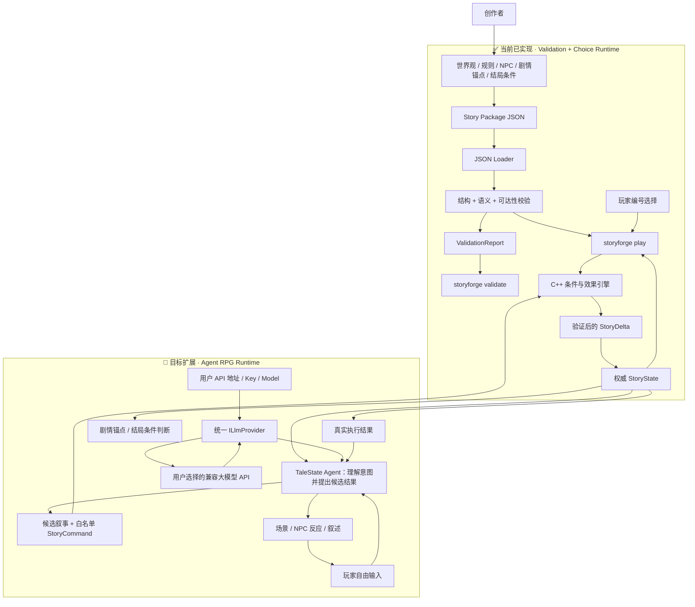

# TaleState C++ 📖

> Bring your own model. TaleState provides the RPG intelligence and deterministic C++ rule arbitration.
>
> 用户自带 API Key，即可把不同市面大模型接入同一套可靠世界规则的高自由文字 RPG Agent 引擎。

---

## 项目简介 / About

### 中文

**TaleState C++** 是一个独立的高自由度文字 RPG Agent 引擎项目。

创作者负责定义世界观、世界规则、地点、NPC、剧情锚点以及多个结局，但不需要预先写死玩家抵达结局的每一条路线。玩家可以用自然语言自由行动；剧情 Agent 根据世界状态理解意图、扮演 NPC，并生成候选场景、事件与叙述。C++ 引擎是世界事实的唯一裁判，负责验证 Agent 提出的状态变化、原子提交合法结果，并保证物品、金币、关系、事件和结局条件不会被 AI 随意绕过。

项目采用 **BYOK（Bring Your Own Key）**：用户选择自己信任的兼容模型服务，填写 API 地址、API Key 和模型名称。TaleState 不重新训练一个基础模型，而是提供已经为文字 RPG 工程化的 Agent 能力，包括角色职责、上下文组装、可用动作、结构化输出、规则校验、失败修复和记忆管理。用户不需要自己研究复杂提示词，也不必把游戏绑定到某一家模型供应商。

项目追求的不是无限制的 AI 即兴创作，而是**受约束的生成式叙事（Constrained Generative Narrative）**：创作者决定世界与命运的边界，Agent 创造旅途中的道路，玩家决定如何行动，引擎保证世界规则始终可信。

当前版本已完成项目骨架、Story Package v1 校验、BYOK 模型接入层的第一部分，以及 **C++ 固定选项游玩闭环**。现在可以在终端玩通“钟塔学院”的两个结局；自由输入、Agent 规划、模型叙述接入、网络传输和存档仍在开发中。

### English

**TaleState C++** is a standalone, setting- and provider-agnostic agent runtime for high-freedom text RPG worlds.

Creators define the world, hard rules, locations, NPCs, story anchors, and possible endings without scripting every route between them. Players act through natural-language input. A narrative agent interprets intent and proposes scenes, events, NPC reactions, and narration, while the deterministic C++ engine remains the sole authority over world state and ending conditions.

The goal is constrained generative narrative rather than unrestricted AI improvisation: creators set the boundaries, the agent creates possible paths, players decide how to act, and the engine ensures that the world never cheats.

TaleState uses a BYOK model: users supply the endpoint, API key, and model of a compatible service. TaleState supplies the RPG-specific agent workflow, structured actions, validation, repair, and memory strategy, so model choice does not define the rules of the world.

The current release includes Story Package v1 validation, the first provider-neutral API layer, and a deterministic C++ choice-based play loop with two endings. Built-in networking, free-form input, agent orchestration, model-generated narration, and save files are not implemented yet.

---

## 🔑 开箱即用的 BYOK 模式 / Bring Your Own Key

最终用户不需要训练模型，也不需要从零编写一套文游提示词。首次启动时只需配置：

```text
API 类型：OpenAI-compatible
Base URL：https://你的模型服务地址/v1
API Key：由用户自己的模型服务商提供
Model：用户选择的模型名称
```

TaleState 在模型与游戏世界之间提供同一套专用能力：

| TaleState 提供 | 用户获得 |
|---|---|
| 文游 Agent 的角色与工作流 | 模型知道自己何时规划、何时调用规则、何时只负责叙述 |
| 精简且有权限边界的上下文 | NPC 不该知道的秘密不会仅因为模型“猜到”就成为世界事实 |
| 结构化候选命令 | 大模型输出先变成可检查的数据，而不是直接篡改存档 |
| 校验失败后的修复循环 | 非法行动会被解释和重试，不会将半套错误结果写入世界 |
| 统一 Provider 接口 | 更换兼容模型时不需要重写剧情和规则引擎 |
| C++ 权威状态与事件日志 | 物品、金币、关系、时间和结局条件保持可验证、可追踪 |

> 这里的“开箱即用”是指 TaleState 会把文字 RPG 所需的 Agent 能力预设并工程化，而不是替用户训练或微调一个新的基础模型。用户带来模型能力，TaleState 让这份能力遵守同一套游戏规则。

**一句话原则：AI 负责想象，TaleState 负责让世界保持真实。**

---

## ✨ 已实现功能 / Implemented Features

### 👤 使用者视角 / For Story Authors

| 功能 | 说明 |
|---|---|
| 📦 Story Package v1 | 使用 JSON 编写受控场景、剧情锚点原型、选项、条件和效果 |
| ✅ 剧情包校验命令 | 使用 `storyforge validate <目录或文件>` 检查内容包 |
| 🎮 C++ 可玩闭环 | 使用 `storyforge play <目录或文件>` 选择行动，推进状态并抵达结局 |
| 🧱 结构错误诊断 | 检查 JSON 语法、必填字段、字段类型、未知字段、ID 和版本格式 |
| 🔗 剧情引用诊断 | 检查无效入口、缺失变量、错误节点、场景和章节引用 |
| 🗺️ 可达性检查 | 从剧情入口遍历显式跳转，拒绝无法到达的节点 |
| 🧭 精确错误位置 | 输出错误代码、JSON 路径和可读错误信息，并返回非零退出码 |
| 🏫 原创示例世界 | 提供“钟塔学院：失准的晨钟”，用固定双分支验证格式与校验流程 |
| 📐 机器可读规范 | 提供 Story Package v1 JSON Schema 和对应格式说明 |
| 🔑 BYOK 接入基础 | 用户可以在未来宿主应用中提供自己的 API 地址、Key 和模型，无需绑定官方账号 |

> 当前工具的直接使用者仍是剧情包作者与集成开发者。Story Package v1 是验证安全边界的第一版格式，并不代表最终玩法会被限制为固定节点树；自由行动与 Agent 驱动的中间剧情将在运行时阶段加入。

### 👨‍💻 开发者视角 / For Developers

| 实现 | 技术说明 |
|---|---|
| 🧩 强类型领域模型 | 章节、场景、节点、选项、变量等使用不同的强类型 ID，为后续世界状态提供基础 |
| 🔀 条件与效果模型 | 使用 `std::variant` 表达类型化条件和效果，避免核心逻辑依赖巨大字符串分支 |
| 🪹 递归组合条件 | 支持 `all`、`any`、`not` 以及变量、物品、金币、场景、事件和 NPC 记忆条件 |
| ⚙️ 通用效果类型 | 建模变量修改、金币、物品、场景切换、章节推进、NPC 记忆、事件和叙事追加 |
| 🎲 确定性运行时 | 计算条件、执行效果、拒绝无效行动，并在整轮成功后一次性提交 `StoryState` |
| 📥 安全 JSON 加载 | 使用 nlohmann/json；限制输入为 16 MiB，并在构造模型前执行结构检查 |
| 🛡️ 两阶段校验 | 分离结构校验与跨对象语义校验，生成统一 `ValidationReport` |
| 🕸️ 图遍历诊断 | 从入口沿节点、场景和章节跳转分析不可达内容 |
| 🧰 可复用核心库 | 校验能力位于独立 `storyforge` C++ 库，不依赖 Qt、数据库或任何特定 AI Provider |
| 🔌 统一模型接口 | `ILlmProvider` 隔离 Agent 与具体模型服务，`IHttpTransport` 隔离协议与宿主网络库 |
| 🌐 兼容协议适配 | `OpenAiCompatibleProvider` 构造 `/chat/completions` 请求并解析内容、用量和请求 ID |
| 🔐 BYOK 安全边界 | 校验 HTTPS、限制请求与响应体大小、日志描述自动隐藏 API Key，并区分可重试错误 |
| 🧪 自动化测试 | Catch2 覆盖合法包、损坏 JSON、缺字段、重复 ID、坏引用、非法效果与不可达节点 |
| 🔄 跨平台 CI | GitHub Actions 在 Windows 与 Linux 上构建、测试并验证示例剧情包 |

---

## 🛠️ 技术栈 / Tech Stack

| 层次 / Layer | 技术 / Technology |
|---|---|
| 开发语言 / Language | **C++20** |
| 构建系统 / Build | **CMake 3.24+** |
| JSON 解析 / Parsing | **nlohmann/json 3.11.3** |
| 模型接口 / Model API | **Provider-neutral C++ API + OpenAI-compatible adapter** |
| 密钥模式 / Credentials | **BYOK（用户自带 API Key）** |
| 格式规范 / Schema | **JSON Schema Draft 2020-12** |
| 命令行 / CLI | **CLI11 2.4.2** |
| 自动测试 / Testing | **Catch2 3.7.1 + CTest** |
| 持续集成 / CI | **GitHub Actions — Windows + Linux** |
| 许可证 / License | **MIT** |

---

## 🏗️ 系统架构 / Architecture



### 安全边界 / Trust Boundary

```text
创作者世界设定、硬规则与结局条件
    ↓
Story Package / WorldSpec 候选 JSON
    ↓
JSON Schema 结构校验
    ↓
C++ 语义校验
    ↓
玩家自由输入 → Agent 生成候选叙事与候选命令
    ↓
C++ 白名单命令校验 → StoryDelta 完整验证
    ↓
原子提交权威 StoryState
    ↓
Agent 只能根据真实执行结果进行叙述
```

当前 `play` 使用编号选择，C++ 引擎已经是状态变化的唯一入口；整轮效果先在临时状态中检查，失败时真实状态保持不变。未来 Agent 负责想象，引擎继续负责判定。剧情 JSON 和 AI 输出都不能执行代码、直接修改数据库或绕过 C++ 规则。API Key 只属于用户的本地运行配置，不属于 Story Package、存档或事件日志。

---

## 📂 项目结构 / Project Structure

```text
talestate-cpp/
├── CMakeLists.txt                    # 顶层构建配置与固定版本依赖
├── README.md                         # 项目说明和快速开始
├── LICENSE                           # MIT License
├── SECURITY.md                       # 输入边界与安全报告方式
├── CONTRIBUTING.md                   # 贡献与测试约定
│
├── include/storyforge/               # 公共 C++ API
│   ├── agent/llm_provider.hpp        # BYOK 配置、统一模型接口与 HTTP 传输边界
│   ├── model/story_types.hpp         # 强类型 ID、条件、效果和 Story Package
│   ├── io/story_loader.hpp           # JSON 加载接口
│   ├── runtime/story_runtime.hpp     # 状态初始化、条件求值和命令执行接口
│   └── validation/validation.hpp     # 校验问题、报告和校验入口
│
├── src/
│   ├── agent/openai_compatible_provider.cpp # 兼容请求构造、响应解析和安全检查
│   ├── io/story_loader.cpp           # JSON 解析与结构检查
│   ├── runtime/story_runtime.cpp     # 原子状态推进、效果计算与运行时错误
│   └── validation/story_validator.cpp # 引用、效果与图可达性检查
│
├── apps/storyforge-cli/
│   └── main.cpp                      # storyforge validate / play 命令
│
├── schemas/
│   └── story-package-v1.schema.json # Story Package v1 JSON Schema
│
├── examples/clockwork-academy/
│   └── story.json                    # 原创双分支示例剧情
│
├── demos/storyagent-python/           # 独立 Python 可玩原型，不参与 C++ 构建
│   └── README.md                     # 原型运行方式与范围
│
├── tests/
│   ├── loader_tests.cpp              # 加载与结构校验测试
│   ├── provider_tests.cpp            # BYOK 请求、脱敏、HTTPS 与错误处理测试
│   ├── runtime_tests.cpp             # 双结局、条件、原子提交和状态推进测试
│   ├── validator_tests.cpp           # 语义与可达性测试
│   └── fixtures/                     # 非法剧情包测试数据
│
└── docs/format/
    └── story-package-v1.md           # Story Package v1 格式说明
```

---

## 📊 当前进度 / Progress

### ✅ 已完成 / Completed

- [x] C++20 与 CMake 项目骨架
- [x] Windows / Linux GitHub Actions
- [x] Story Package v1 数据格式与 JSON Schema
- [x] 强类型剧情领域模型
- [x] 条件与效果 `std::variant` 类型系统
- [x] JSON 加载和结构校验
- [x] 重复 ID 与缺失引用检查
- [x] 剧情入口和归属关系检查
- [x] 非法变量效果检查
- [x] 剧情节点可达性分析
- [x] `storyforge validate` 命令
- [x] 原创分支剧情示例
- [x] Provider 无关的 `ILlmProvider` 接口
- [x] 可替换的 `IHttpTransport` 网络边界
- [x] OpenAI-compatible Chat Completions 请求与响应适配
- [x] BYOK 配置校验、API Key 脱敏和请求/响应大小限制
- [x] 权威 `StoryState` 初始化、条件求值与效果计算
- [x] `StoryCommand → StoryDelta → StoryEvent` 和原子状态提交
- [x] `storyforge play` 命令行游玩循环
- [x] 玩家选择后推进节点、变量、物品、NPC 记忆和事件
- [x] 钟塔学院两个可游玩的结局
- [x] 25 项自动化测试

### 🚧 下一阶段 / Next Phase

- [ ] 为桌面端或 CLI 接入真正的 HTTPS 网络传输实现
- [ ] 首次启动的 API 地址、Key、模型配置与连通性测试
- [ ] API Key 的系统安全凭据存储，禁止进入配置明文、日志和存档
- [ ] Agent 上下文构建、结构化候选命令和校验失败修复循环
- [ ] 自然语言输入映射为候选命令，并复用现有 C++ 判定
- [ ] 将 LLM 叙述接到已提交的事件结果上
- [ ] 更丰富的关系状态和动态结局条件
- [ ] 固定随机种子与黄金结果测试

### 📋 后续规划 / Planned

- [ ] `WorldSpec`：世界观、硬规则、势力、地点、NPC 与秘密
- [ ] 剧情锚点和结局条件，不把中间过程写死为固定节点树
- [ ] Provider 无关的 `IStoryAgent` 与自然语言行动解释
- [ ] 多家模型协议适配器及本地模型服务支持
- [ ] Agent 候选叙事、白名单命令、校验反馈与修复循环
- [ ] NPC 目标、关系、记忆和主动行为
- [ ] 动态场景、线索、冲突与世界事件生成
- [ ] 自动模拟、死路、状态矛盾和结局可达性诊断
- [ ] 内存状态存储与 SQLite 持久化
- [ ] 存档版本和迁移机制
- [ ] 创作者界面：定义世界、规则、剧情锚点和结局
- [ ] 玩家界面：自由输入、叙事输出、状态与存档
- [ ] Qt、Web 或其他宿主适配器

---

## 🚀 快速开始 / Quick Start

主项目现在可以直接在 C++ 命令行玩通“钟塔学院”。想体验早期“规则判定 + AI 描写”实验，也可以运行独立的 [StoryAgent Python Demo](demos/storyagent-python/README.md)；它使用自己的简化场景格式与 DeepSeek API。

### 环境要求 / Prerequisites

| 依赖 | 版本 |
|---|---|
| CMake | 3.24+ |
| 编译器 | MSVC 2022 / GCC 11+ / Clang 14+ |
| C++ 标准 | C++20 |

首次配置会从官方仓库下载并校验固定版本的 nlohmann/json、CLI11 和 Catch2。

### 1️⃣ 获取源码 / Clone

```bash
git clone https://github.com/stellablack528/talestate-cpp.git
cd talestate-cpp
```

### 2️⃣ 配置与构建 / Configure and Build

```bash
cmake -S . -B build -DSTORYFORGE_BUILD_TESTS=ON
cmake --build build --config Release
```

### 3️⃣ 验证示例剧情 / Validate the Example

Linux 或单配置生成器：

```bash
./build/storyforge validate examples/clockwork-academy
```

Visual Studio 等多配置生成器：

```powershell
.\build\Release\storyforge.exe validate .\examples\clockwork-academy
```

成功输出：

```text
valid Story Package v1: 钟塔学院：失准的晨钟 (clockwork-academy @ 0.1.0)
1 chapter(s), 0 warning(s)
```

也可以直接传入 JSON 文件：

```bash
storyforge validate examples/clockwork-academy/story.json
```

### 4️⃣ 游玩示例 / Play the Example

Linux 或单配置生成器：

```bash
./build/storyforge play examples/clockwork-academy
```

Visual Studio 等多配置生成器：

```powershell
.\build\Release\storyforge.exe play .\examples\clockwork-academy
```

Windows 上使用 MinGW 单配置构建时：

```powershell
.\build\storyforge.exe play .\examples\clockwork-academy
```

输入 `1` 观察齿轮，再输入 `1` 修钟；或者先输入 `2` 报告导师，再输入 `2` 封存异常。条件不满足的选项会标注并拒绝执行，输入 `0` 可以退出。目前叙事来自剧情包本身，不会调用模型，也无需 API Key。

---

## 🧪 测试 / Testing

```bash
ctest --test-dir build -C Release --output-on-failure
```

当前自动测试覆盖：

- 合法 Story Package 的加载和校验
- 损坏 JSON 的拒绝
- 缺失必填字段
- 未知字段、非法 ID 与版本号
- 重复标识符
- 缺失节点引用
- 无效剧情入口
- 不可达节点
- 非法变量效果
- 观察齿轮后获得物品、修钟消耗物品并抵达结局
- 条件不足时拒绝行动，状态不变化
- 后续效果失败时整轮回滚、整数溢出保护和场景跳转
- 金币扣减、NPC 记忆、事件条件与跨章节推进

当前基线：**25/25 测试通过**。

其中模型接口测试使用内存中的假网络传输，不会读取真实 API Key、访问外部服务或产生模型费用。

---

## 📝 Story Package v1 顶层结构示意

```json
{
  "format": "storyforge.package/v1",
  "id": "example-story",
  "title": "Example Story",
  "version": "0.1.0",
  "entry": {
    "chapter": "chapter.start",
    "scene": "scene.hall",
    "node": "node.entry"
  },
  "variables": [],
  "chapters": []
}
```

完整字段定义见 [Story Package v1 格式说明](docs/format/story-package-v1.md) 和 [JSON Schema](schemas/story-package-v1.schema.json)。请注意：上面的片段只展示顶层形状，空章节数组不能通过语义校验；可运行示例请参考 [Clockwork Academy](examples/clockwork-academy/story.json)。

Story Package v1 目前以固定节点和显式选择验证加载、引用与规则边界。它是 Agent 运行时的安全基础，而不是最终玩法上限。后续格式会进一步区分世界事实、剧情锚点、结局条件、权威状态与 Agent 候选事件，让中间剧情可以根据玩家自由行动动态发展。

---

## 🎯 项目目标 / Goals

- 让创作者只需定义世界观、硬规则、NPC、剧情锚点和多个结局，不必写死全部路线。
- 让玩家通过自然语言自由行动，使同一世界产生不同的过程、关系和结果。
- 让用户自带兼容模型 API，在不同市面模型之间切换，而不改变世界规则与剧情内容。
- 将文字 RPG 所需的提示、上下文、动作协议、校验和修复流程产品化，做到配置模型后即可使用。
- 让 Agent 动态生成合理的场景、事件和 NPC 反应，但不能直接控制世界事实。
- 由确定性 C++ 引擎裁决条件、效果、资源、关系、事件和结局状态。
- 将创作内容、Agent、规则执行、UI、数据库与具体 AI Provider 解耦。
- 让关键状态变化可验证、可测试、可记录，并能通过种子与事件日志复现。
- 最终形成“创作者定义边界、Agent 创造道路、玩家决定行动、引擎保证规则”的高自由文字 RPG Agent。

---

## 👤 维护者 / Maintainer

[@stellablack528](https://github.com/stellablack528)

---

## 📄 License

MIT License — See [LICENSE](LICENSE) for details.
